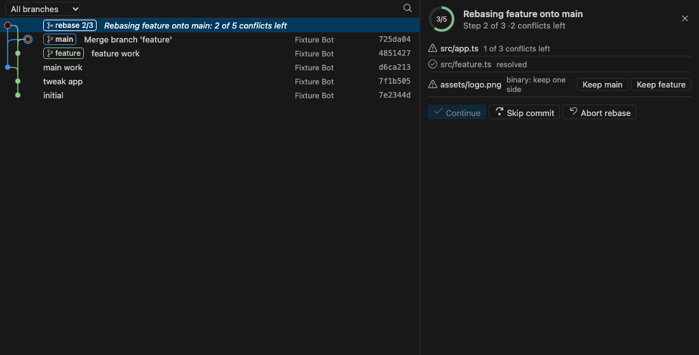

# Resolve conflicts with context

When a merge, rebase, cherry-pick or revert stops with conflicts, each conflict gets
**Accept Current / Incoming / Both**, **Pick Lines…**, **Compare** and **Explain**, with who last changed
it on each side. Files deleted, renamed or binary on one side get a card instead.

In the graph, the operation in progress is a node joining both sides: select it to see every file,
your progress, and **Continue**, **Skip** or **Abort**.

