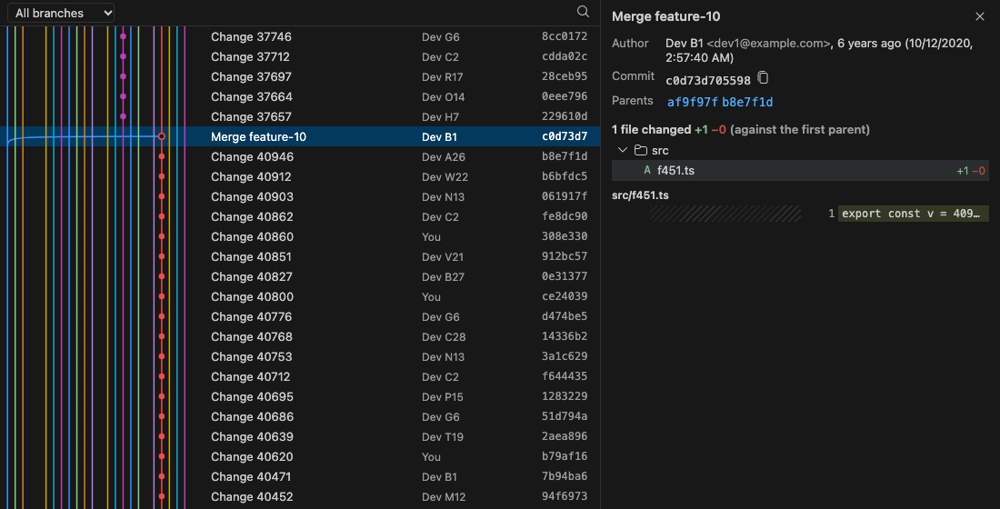

# A graph that follows your cursor

The **GitVision** panel shows every commit, smoothly, even in repositories with 100,000+ commits.

- As you move in the editor, the commit that last changed your line is highlighted. Pause, and the
  line's whole history is ringed.
- Click a commit for its message and changed files; hover a file for a small diff.
- Press <kbd>/</kbd> to search, or filter to the current branch, any other branch, or the active file.
- Right-click a commit for checkout, branch, tag, cherry-pick, revert, reset and compare. Drag one
  branch label onto another to merge or rebase. Every change to your repository asks first.

