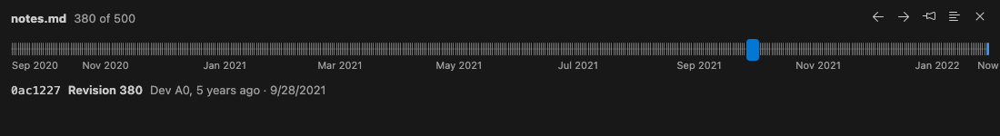

# Time travel through a file

Step the file in front of you back through every version it has had:

- <kbd>Alt</kbd>+<kbd>[</kbd> and <kbd>Alt</kbd>+<kbd>]</kbd> while travelling, or the **history** button
  in the editor title, or the **Time Travel** slider in the panel.
- Added lines are tinted and removed lines appear in red where they were. You stay at the same place
  in the code as you step.
- Pin a version to compare every later step against it. <kbd>Escape</kbd> returns to your file.

